# codeforces-tags

By Max Sobroza ([@msobroza](https://github.com/msobroza)).
Built with [Claude Code](https://claude.com/claude-code) as a coding agent, under the rules of [`CLAUDE.md`](CLAUDE.md); every frozen result is checked by code in this repository.

**Multi-label tagging of Codeforces problems: TypeSafe Jev against zero-shot LLMs, fine-tuned encoders, dense embeddings and TF-IDF, under one leak-free protocol.**

On 4,982 Codeforces problems (English statements and Python solutions, 8 algorithm tags), [TypeSafe](https://docs.typesafe.ai/)'s Jev, one API call that answers eight yes/no tag questions with probabilities, shares the top of 16 frozen methods with the best zero-shot gpt-6-luna prompt. On dev, where every choice is made, Jev scores 0.729 macro F1 against the prompt's 0.732, a difference within noise, at about a fifth of its latency. On the test set, scored once as a reference, Jev's 0.75 is the highest point estimate, statistically level with that prompt and two F2LLM embedding methods. On both, Jev is clearly ahead of TF-IDF and fine-tuned ModernBERT, at 0.26 s and about $0.13 per 1,000 problems.


*Test macro F1 (994 problems, scored once) against the median latency of one prediction with the model loaded, log scale; a label such as "TypeSafe Jev ×2" groups the variants of one family in the table below. The dashed line is the 10 s limit that the task statement ([`PROBLEM.md`](PROBLEM.md)) sets for one prediction; loading a method is not counted (see Limitations). Read it with care: the y axis starts at 0.62, the points carry no error bars, and test intervals are about ±0.03. The highest point, `jev-statement-code`, is statistically level with the next four (`f2llm_late_fusion`, `f2llm_probe`, `descode2tag-json`, `jev-statement`), but not with the sixth, `f2llm_early_fusion` (paired −0.021 [−0.041, −0.001]). GPU methods ran on one RTX 2080 Ti. API latencies were measured from the author's machine and include the network. The label prior and the three Jev reference variants are not drawn.*

## Results

Macro F1 is the mean of the 8 per-tag F1 scores, so a rare tag counts as much as `math`. **Dev**: 3,988 problems scored *out of fold*: they are cut into 5 folds, and each fold is predicted by a model fitted on the other four, so no prediction comes from a model fitted on that problem's labels. Every eligible method's settings were chosen on dev alone. **Test**: 994 problems, scored once per method and never used to choose. Brackets are 95% *group-bootstrap* intervals: the problems are resampled 2,000 times, each kept with its near-duplicates (an easy and a hard version of one problem); a *paired* interval scores two methods on the same resamples. Latency is the median of one prediction with the model loaded. Cost is USD per 1,000 problems. Bold marks the best eligible score; the three Jev references at the bottom are never eligible.

| Method | Family | How it works | Test macro F1 [95% CI] | Dev macro F1 | Median latency | $ / 1k |
|---|---|---|---|---|---|---|
| **`jev-statement-code`** (CLI default) | TypeSafe Jev | 8 yes/no questions on statement + solution, per-tag thresholds | **0.7515** [0.7203, 0.7770] | 0.7293 | 0.260 s | 0.134 |
| `jev-statement` | TypeSafe Jev | the same questions, statement only | 0.7367 [0.7033, 0.7648] | 0.7289 | 0.249 s | 0.116 |
| `descode2tag-json` | Zero-shot LLM | paper's DesCode2Tag prompt to gpt-6-luna, JSON tag list | 0.7407 [0.7063, 0.7696] | **0.7319** | 1.213 s | 0.132 |
| `descode2tag-text` | Zero-shot LLM | the same prompt, free-text answer | 0.7209 [0.6888, 0.7499] | 0.7061 | 0.985 s | 0.114 |
| `code2tag-json` | Zero-shot LLM | paper's Code2Tag prompt: the solution alone, JSON | 0.6668 [0.6208, 0.7052] | 0.6514 | 1.137 s | 0.079 |
| `code2tag-text` | Zero-shot LLM | the solution alone, free text | 0.6314 [0.5897, 0.6693] | 0.6421 | 1.087 s | 0.061 |
| `f2llm_late_fusion` | Dense embeddings | probe scores blended with TF-IDF scores | 0.7477 [0.7150, 0.7749] | 0.7057 | 0.138 s, GPU | free |
| `f2llm_probe` | Dense embeddings | frozen F2LLM-0.6B embeddings, a ridge head (a linear classifier on them) | 0.7415 [0.7084, 0.7700] | 0.7087 | 0.127 s, GPU | free |
| `f2llm_early_fusion` | Dense embeddings | one linear SVM on embeddings + TF-IDF | 0.7301 [0.6964, 0.7593] | 0.7022 | 0.137 s, GPU | free |
| `modernbert_base_full` | Fine-tuned encoder | ModernBERT-base, all weights, bag of 5 fold models | 0.7039 [0.6659, 0.7370] | 0.6530 | 0.360 s, GPU | free |
| `modernbert_lora` | Fine-tuned encoder | ModernBERT-large + LoRA (small trained adapters on frozen weights), bag of 5 fold models | 0.6954 [0.6585, 0.7269] | 0.6611 | 0.335 s, GPU | free |
| `tfidf` | TF-IDF | word + code-token TF-IDF, a linear SVM per tag | 0.6888 [0.6494, 0.7213] | 0.6629 | 0.007 s, CPU | free |
| `label_prior` | Floor | predicts all 8 tags, reads nothing | 0.1487 [0.1393, 0.1578] | 0.1485 | < 1 ms | free |
| *`jev-statement-code-platt`* ² | Jev, reference | base's answers, Platt + Lipton thresholds | 0.7451 [0.7140, 0.7716] | 0.7379 | 0.260 s | 0.134 |
| *`jev-statement-code-gepa-platt`* ¹ ² | Jev, reference | both changes | 0.7405 [0.7086, 0.7675] | 0.7367 ¹ | 0.257 s | 0.139 |
| *`jev-statement-code-gepa`* ¹ | Jev, reference | tag definitions rewritten by a GEPA search | 0.7268 [0.6918, 0.7582] | 0.7302 ¹ | 0.257 s | 0.139 |

¹ In sample on dev: the words were searched on dev folds. ² `test_informed`: the threshold rule was proposed after a test score had been read. These three are references and are never eligible as the default. A method is eligible when its dev score is out of fold (not `dev_in_sample`), its rule was not proposed after a test score was read (not `test_informed`), and its slowest timed prediction takes under 10 s ([ADR 0004](docs/adr/0004-tagging-method-framework.md)). *Platt + Lipton*: each tag's probabilities are remapped by a logistic fit on their logit (Platt scaling), and the threshold is set at half the best F1 (Lipton et al., 2014). *GEPA*: a prompt-evolution search in which an LLM reads Jev's errors and rewrites the tag definitions. A 17th method, `f2llm_setfit`, is registered and tested but was never frozen.

On test, the paired difference from `jev-statement-code` has an interval that includes 0 for `f2llm_late_fusion`, `f2llm_probe`, `descode2tag-json`, `jev-statement` and `jev-statement-code-platt`. Those five are statistically tied with it.

### Key findings

1. **A shared top tier, on dev and on test.** On dev, `descode2tag-json` (0.7319) and `jev-statement-code` (0.7293) are within noise of each other (finding 2). On test, which is scored once and decides nothing, `jev-statement-code` has the highest point estimate of the 16, 0.7515 [0.7203, 0.7770], but five other methods are within noise of it (above): the top of the table is a tie, not a ranking.
2. **On dev, the best zero-shot prompt edges ahead.** `descode2tag-json` scores 0.7319 against Jev's 0.7293, a paired +0.0025 [−0.0114, +0.0167]: a tie. The project's mechanical rule (best eligible dev score) names DesCode2Tag-json. The CLI default is Jev for its latency: 0.260 s against 1.213 s at the median (4.7 times faster) and 0.570 s against 3.648 s at the slowest, for about the same price ($0.134 against $0.132 per 1,000 problems, as in the table). See [ADR 0008](docs/adr/0008-cli-default-method.md).
3. **Clear wins over the trained baselines.** Jev is ahead of TF-IDF and both fine-tuned ModernBERT models by about 0.07 on dev and 0.05 to 0.06 on test, and ahead of the three F2LLM heads by 0.02 to 0.03 on dev. Every one of these intervals excludes 0. On test, the F2LLM probe and late fusion are level with Jev.
4. **No training beyond eight thresholds.** Jev learns one threshold per tag from the dev labels, cross-fitted out of fold, and nothing else. The thresholds matter: the raw probabilities are too high on most tags (they overstate how often a tag is true), and a fixed 0.5 cut would cost −0.039 [−0.053, −0.025] macro F1. Ranking is strong (macro AUC 0.954: the chance that a problem with the tag outranks one without it, averaged over tags), and a Platt map fitted out of fold brings the mean expected calibration error from 0.053 to 0.011.
5. **No family wins every tag, and no tag has a clear winner.** On test, Jev's point estimate is top on geometry and games and level with F2LLM's on probabilities; the zero-shot prompt is top on graphs, number theory and trees, and F2LLM on math and strings. Every difference between Jev and the top representative of a tag has an interval that includes 0, on dev and on test. Where an interval excludes 0, Jev is ahead of a weaker method (e.g. on graphs against TF-IDF and ModernBERT, on dev and on test).
6. **The statement carries most of the signal.** Code-only prompts reach 0.642 to 0.651 on dev; statement plus code, 0.706 to 0.732. For Jev, adding the solution changes dev macro F1 by 0.000 [−0.008, 0.009]: it helps graphs and trees, hurts strings and games, and adds about 15% more input tokens. A JSON schema beats free text for DesCode2Tag (+0.0258 [+0.0142, +0.0370] on dev).
7. **What did not help.**
   - A GEPA search over Jev's tag definitions ($9.95): +0.006 [−0.006, 0.022] on a held-out fold, −0.025 [−0.041, −0.010] on test. Better probabilities did not make better tags.
   - A Platt + Lipton threshold rule: +0.009 [0.001, 0.017] on dev but −0.006 [−0.013, 0.001] on test for the main method. It buys stable thresholds, not accuracy.
   - Fine-tuning ModernBERT: no gain over TF-IDF on dev (0.661 and 0.653 against 0.663), after 5.0 h (LoRA) and 3.6 h (base) of GPU tuning on one fold and about an hour of fold-model training each.
   - Fusing F2LLM embeddings with TF-IDF: no gain over the plain probe on dev.

### Results by tag


*Test F1 per tag with 95% intervals; the number after each tag is its count of test positives. Test only: four of the five representatives of the table below (ModernBERT LoRA is left out).*

Test F1 of each family's representative, the eligible method with the best dev score in its family (chosen on dev, not on test; the three Jev references are never eligible):

| Tag (test positives) | Jev | Zero-shot | F2LLM probe | ModernBERT LoRA | TF-IDF | Top on test |
|---|---|---|---|---|---|---|
| math (281) | 0.659 | 0.638 | **0.672** | 0.641 | 0.619 | F2LLM, interval includes 0 |
| graphs (108) | 0.713 | **0.721** | 0.675 | 0.586 | 0.557 | Zero-shot, interval includes 0 |
| strings (85) | 0.663 | 0.622 | **0.670** | 0.654 | 0.660 | F2LLM, interval includes 0 |
| number theory (72) | 0.659 | **0.695** | 0.675 | 0.611 | 0.518 | Zero-shot, interval includes 0 |
| trees (63) | 0.767 | **0.794** | 0.787 | 0.727 | 0.772 | Zero-shot, interval includes 0 |
| geometry (33) | **0.781** | 0.761 | 0.706 | 0.645 | 0.706 | Jev, interval includes 0 |
| games (21) | **0.927** | 0.884 | 0.905 | 0.878 | 0.878 | Jev, interval includes 0 |
| probabilities (18) | **0.842** | 0.811 | **0.842** | 0.821 | 0.800 | Jev and F2LLM, tied |

"Interval includes 0" refers to the paired difference between the top representative and Jev, or, where Jev is top, between Jev and the runner-up: no tag has a clear winner on test. Rare tags are noisy: Jev's probabilities F1 is 0.842 [0.690, 0.950].

## When to use which family

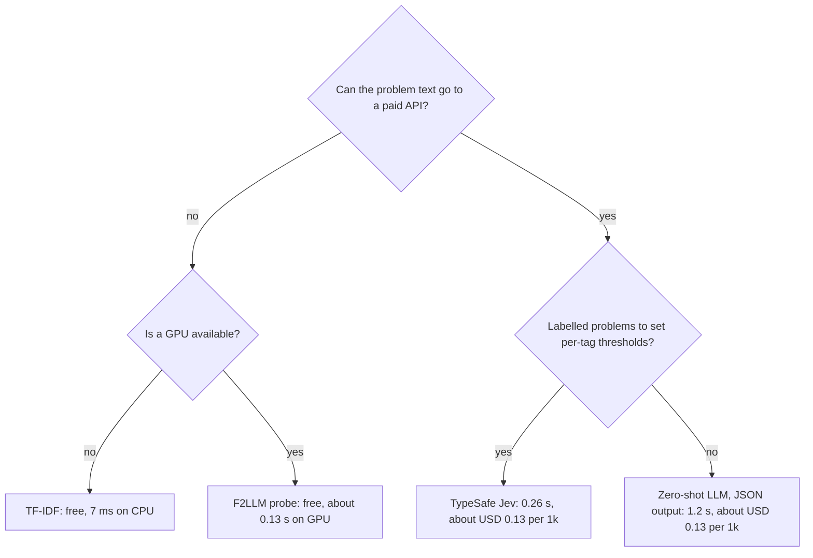

| Family | Use it when | Avoid it when |
|---|---|---|
| **TypeSafe Jev** | Tags can be written as yes/no definitions; you have labelled problems to set thresholds (here 3,988); you want no GPU and no training; 0.26 s and $0.13 per 1,000 problems are fine | Text must stay private or offline; you need bit-exact replays; volume makes a free local model attractive |
| **Zero-shot LLM** (DesCode2Tag, JSON) | You have no labels at all, or want tags beyond the 8 (the prompt lists all 37; macro F1 over all 37 tags is 0.49 on dev) | You need sub-second answers; answers are 0/1 with no score to tune |
| **Dense embeddings** (F2LLM) | You have a GPU and need free, local inference; the probe is 0.021 below Jev on dev (interval excludes 0) and level with it on test | Cold start matters (8 to 12 s to load) or CPU only (3.0 to 3.7 s median); 1.19 GB of weights, a 7.89 GB served image |
| **TF-IDF** | You need offline, free, 7 ms predictions on a CPU at any volume, from a 906 MB served image; it is competitive on strings and games | You need the best accuracy: Jev adds about 0.07 macro F1 on dev |
| **Fine-tuned ModernBERT** | Not recommended on this data | No dev gain over TF-IDF; 3.3 GB of trained fold models; GPU retrains vary |
| **Label prior** | A sanity floor (0.149) | Always, as a model |

## The benchmark

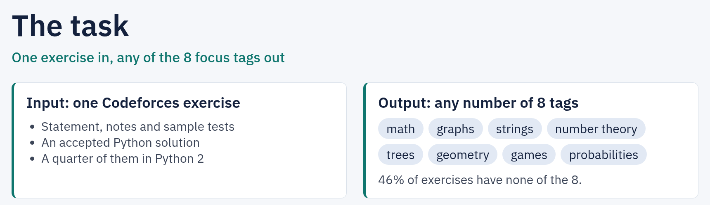

- **Unit.** One Codeforces problem with one accepted Python solution: 4,982 problems from xCodeEval, released from 2010-02-19 to 2022-11-21.
- **Target.** Any number of 8 focus tags: `math`, `graphs`, `strings`, `number theory`, `trees`, `geometry`, `games`, `probabilities`. The dataset has 37 tags; the other 29 are out of scope.
- **Input.** The statement (description, input and output spec), the notes and the solution. Difficulty, release date and Python version are left out on purpose: a new problem has no difficulty, and the others are release-era cues.
- **Quirks.** 24.9% of solutions are Python 2, so code is read as regex tokens, never parsed. 17 statements are mostly Russian; the rest are English.
- **Latency target.** One prediction, for one problem, should take under 10 s ([`PROBLEM.md`](PROBLEM.md)); the first figure and the limitations below measure against it.

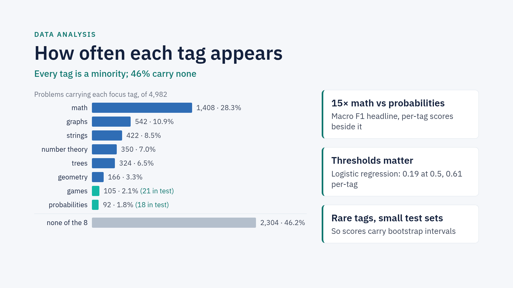

**Why this task suits Jev.** Jev is a "System One" model: it reads a text or JSON state and answers typed questions with probabilities, without writing text.

- **English text and code in.** The state holds the statement and the Python solution side by side.
- **Multi-label out.** [TypeSafe's docs](https://docs.typesafe.ai/concepts/system-one) recommend one yes/no question per condition, many per request. Here, one request carries 8, one per tag.
- **Tags that words can define.** Each tag gets a written yes side and no side. For example, an answer printed modulo 10^9+7 only to keep it small is not number theory.

## Methodology

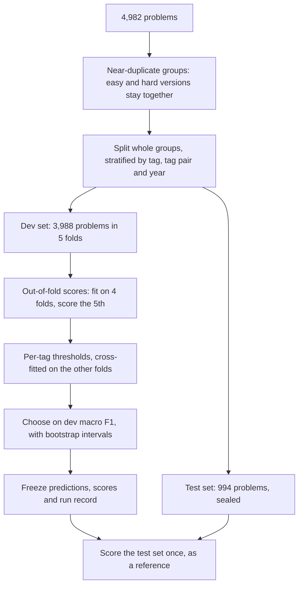

**Near-duplicates.** Codeforces often publishes an easy and a hard version of one problem. A random 80/20 split would put about 26 of the 82 duplicate pairs on both sides, leaking a near copy of a test problem into training. A single similarity threshold fails: at 0.8 it misses 11 pairs, and at 0.4 it chains unrelated problems into groups of up to 11. The detector has two stages: TF-IDF candidates at 0.4 for recall, then the frozen verdicts of two blind LLM judges for precision. The result is 4,900 groups (82 pairs, 4,818 singletons). See [notebook 02](notebooks/02_near_duplicates.ipynb) and [the audit](assets/near_duplicates/README.md).

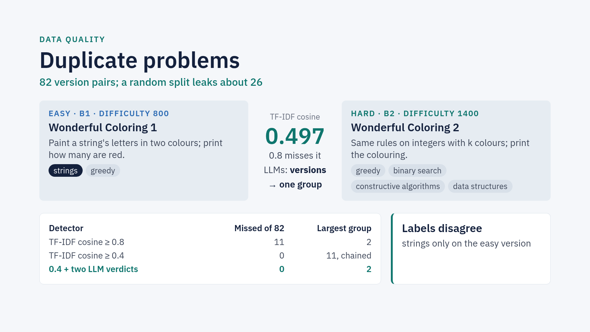

**The split.** Frozen in [`assets/split/split.csv`](assets/split/split.csv): dev 3,988 problems (80%) in 5 folds of 790 to 806, test 994 (20%). Whole groups only. Iterative stratification balances the 8 tags, their 9 frequent pairs and the release year; problems with no focus tag keep their own stratum, because they are 46% of the data and keep precision honest. See [notebook 03](notebooks/03_train_test_split.ipynb).

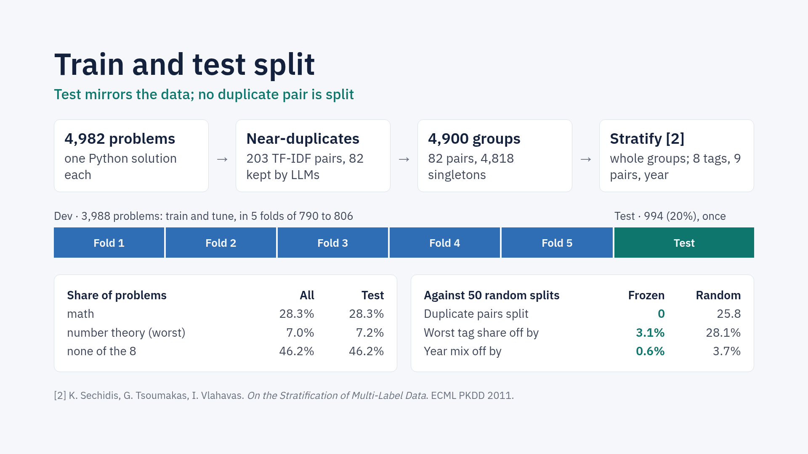

*Folds 1-5 in the figure are folds 0-4 in `split.csv` and the notebooks.*

**Out of fold.** Every dev prediction comes from a model fitted without that problem's labels:

| Round | Fit on | Score |
|---|---|---|
| 1 | folds 1, 2, 3, 4 | fold 0 |
| 2 | folds 0, 2, 3, 4 | fold 1 |
| ... | ... | ... |
| 5 | folds 0, 1, 2, 3 | fold 4 |

**Thresholds.** Score methods (Jev, F2LLM, ModernBERT, TF-IDF) get one F1-maximising threshold per tag, chosen for each fold on the other four folds (*cross-fitted* thresholds). They matter: an untuned logistic regression scores 0.189 macro F1 at a 0.5 cut and 0.612 with cross-fitted thresholds. Zero-shot LLMs answer a tag list and get no threshold.

**Metrics.** Macro F1 over the 8 tags is the headline. Beside it: per-tag precision, recall and F1, micro F1, and a tag confusion matrix. Slices: release era, focus-tagged problems only, and without the 66 problems whose solution names its own problem.

**Intervals.** A group bootstrap: 2,000 resamples of near-duplicate groups, 95% percentile intervals. Every method is scored on the same resamples, so a difference between two methods gets its own paired interval.

**Choice and test.** Models are chosen on dev only ([ADR 0001](docs/adr/0001-model-selection-protocol.md)). Each method's test set is scored once; a changed recipe is a new method. A method whose words were tuned on dev is flagged `dev_in_sample`, and one proposed after reading a test score is flagged `test_informed` ([ADR 0004](docs/adr/0004-tagging-method-framework.md)).

## Methods

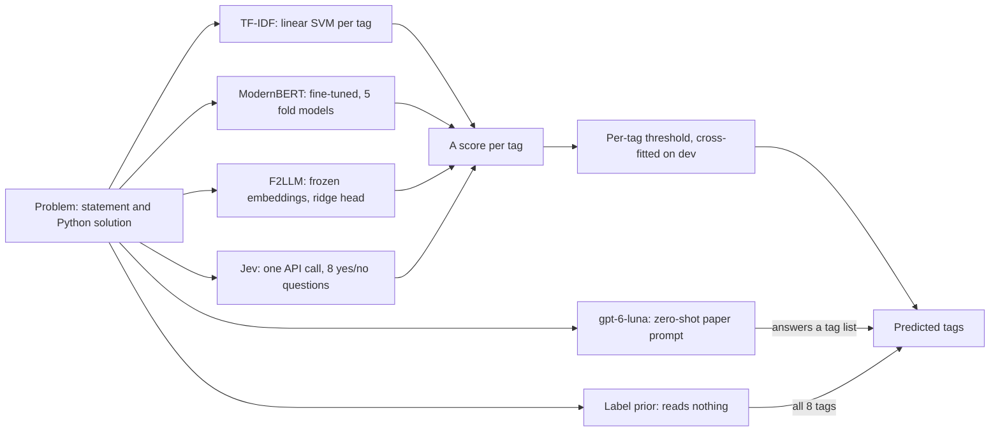

- **Label prior** (`label_prior`): predicts every tag for every problem. The F1 floor.
- **TF-IDF** (`tfidf`): word 1-2-grams of the statement and notes, regex tokens of the code, one linear SVM per tag; about 366K weights, chosen from 203 Optuna trials ([notebook 04](notebooks/04_tfidf_baseline.ipynb)).
- **Fine-tuned encoders** (`modernbert_lora`, `modernbert_base_full`): ModernBERT-large with LoRA, or ModernBERT-base fully trained, on `[CLS] statement [SEP] solution [SEP]`; the method is the bag of its five fold models ([ADR 0005](docs/adr/0005-fine-tuned-model-protocol.md)).
- **Dense embeddings** (`f2llm_*`): frozen F2LLM-0.6B v1 embeddings of the statement and the solution, with a ridge probe, or fused with TF-IDF early or late. v1 because v2's training data holds xCodeEval itself.
- **Zero-shot LLM** (`code2tag-*`, `descode2tag-*`): the xCodeEval paper's Code2Tag (solution only) and DesCode2Tag (statement, notes and solution) prompts, rebuilt because the paper never shows them, sent to gpt-6-luna at reasoning effort none. Each answers in free text or under a strict JSON schema.
- **TypeSafe Jev** (`jev-*`): the pinned model [`jev-1.13.0`](https://docs.typesafe.ai/models), one request per problem, eight yes/no [Noul](https://docs.typesafe.ai/primitives/noul) questions.

### How Jev is asked

Each tag gets one yes/no ("Noul") question, with a shared convention and the tag's own definition. The words live in one versioned file, [`jev-tags.v1.yaml`](src/codeforces_tags/methods/typesafe_jev/templates/jev-tags.v1.yaml), written from Codeforces conventions and frozen before the first request. One question, shortened:

```json
{"type": "noul",
 "instructions": {"tag": "number theory",
   "question": "Would Codeforces put the tag `number theory` on this problem?"},
 "criteria": {
   "true":  {"definition": "The intended solution relies on properties of integers.",
             "includes": ["divisibility, divisors, gcd and lcm", "primes, sieves, factorisation"]},
   "false": {"definition": "Integers are only quantities to add, compare or count.",
             "excludes": ["an answer printed modulo 10^9+7 or 998244353 only to keep it small"]}}}
```

```python
async with typesafe_sdk.AsyncTypeSafeClient(model="jev-1.13.0") as client:
    response = await client.system_one(state={"statement": statement, "solution": source_code},
                                       model="jev-1.13.0", questions=questions)
p = {tag: response.nouls[tag.replace(" ", "_")].noul for tag in FOCUS_TAGS}   # P(yes) per tag
predicted = [t for t in FOCUS_TAGS if p[t] >= threshold[t]]                    # learned out of fold
```

In one picture:

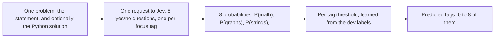

On dev problem 34 (`scores.csv`), Jev answered 0.98 for graphs and for trees and 0.05 or less for the six other tags; it predicted graphs and trees, the true tags. A request is about 3,190 input tokens, output tokens are free, and all 4,982 answers completed with no failure.

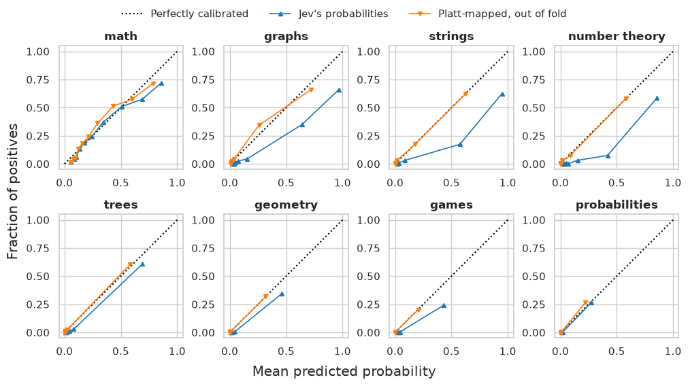

*Jev's probabilities on dev, raw (blue) and after a Platt map fitted out of fold (orange). Raw probabilities are too high on most tags; math is near the diagonal. The per-tag thresholds absorb this. From [notebook 11](notebooks/11_jev_platt.ipynb).*

## Reproducibility and engineering

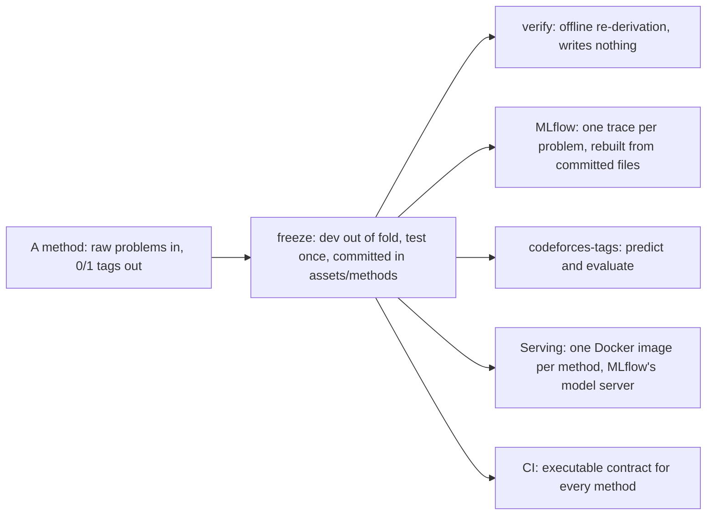

Every score in this README is re-derived offline from the committed predictions and the dataset, whose sha256 the run records check (the labels are not committed). `uv run codeforces-tags methods` prints each method's frozen dev and test macro F1 and its latency, and `uv run codeforces-tags evaluate --method tfidf` prints the `tfidf` row, 0.6888 [0.6494, 0.7213]. The other intervals are group-bootstrap intervals of the frozen predictions (`codeforces_tags.analysis.comparison.method_scores`, 2,000 resamples, seed 0, the call the method notebooks make); no committed command prints this README's tables whole. Latencies are measurements, committed in each method's `latency.csv`, and each API method's costs are in its `per_problem.csv`. The figures are static renders of slides and of notebooks 11 and 12; no command regenerates them.

- **Frozen methods.** Each method lives in `assets/methods/<name>/`, written once by its `freeze` command; a second run only checks.

  | File | Holds |
  |---|---|
  | `predictions.csv` | dev predictions out of fold, test predictions once |
  | `scores.csv` | per-tag scores (score methods) |
  | `run_record.json` | code commit, dataset and split sha256, environment, settings, recipe hash |
  | `model/` | a data-only method folder, loadable without MLflow |
  | `latency.csv` | 50 timed problems, plus load and bulk rows |
  | `answers_*.jsonl`, `per_problem.csv` | API methods: every answer, append-only, keyed by request hash |

- **Verify.** Each `verify` command re-derives the frozen files and writes nothing. For an API method it re-renders every request against its answer's hash and re-parses every answer, with no key and no request. The commit checks of the Jev methods refuse in this public snapshot, by design (Limitations).
- **API methods are fixed reference models.** The prompt, definitions and settings never change after the first dev request; test answers wait until the dev answers are committed ([ADR 0003](docs/adr/0003-api-methods-are-fixed-reference-models.md), [ADR 0007](docs/adr/0007-api-score-methods-share-the-llm-toolkit.md)).
- **Versioned prompts.** One YAML file per prompt version, read with a safe loader, rendered in a strict Jinja2 environment and mirrored in MLflow's prompt registry ([ADR 0009](docs/adr/0009-versioned-prompt-files.md)).
- **MLflow.** One run per method, logged through a single models-from-code wrapper; evaluation datasets `codeforces-dev` and `codeforces-test`; one trace per problem with per-tag correctness. The local store is rebuilt from committed files with no paid call ([ADR 0002](docs/adr/0002-method-folders-and-mlflow-wrapper.md)).
- **No pickle.** Tables are CSV or JSON, arrays `.npz`, scikit-learn models skops with pinned trusted types, weights safetensors. `pickle`, `joblib`, `torch.save` and `torch.load` fail the lint.
- **One contract.** Every method implements one protocol and its tests call `check_tagging_method`; `check_frozen_method` checks every committed folder against the split.
- **Serving.** A served model is built from the committed method folder, never from the MLflow store, and `serving smoke` checks a live server against the frozen test rows (see Serving below).
- **CI.** Six jobs: ruff, pylint, a complexity gate, pytest (a 95% coverage floor on the package, 100% on test lines), and two jobs that test the ModernBERT and F2LLM code on tiny random models, offline. CI needs no dataset and no key, and fails any test that opens a connection outside localhost.

Decisions that are hard to reverse are recorded in [`docs/adr/`](docs/adr/) (12 ADRs); domain words are defined in [`CONTEXT.md`](CONTEXT.md).

## Quickstart

Needs [uv](https://docs.astral.sh/uv/), which installs Python 3.12: the version that `.python-version` pins, and the one CI and the served images run. `pyproject.toml` also allows 3.11, which is untested.

```bash
git clone https://github.com/msobroza/codeforces-tag-prediction.git
cd codeforces-tag-prediction
uv sync
uv run codeforces-tags methods
```

### Data

The dataset is not shipped here. It is a 4,982-problem subset of xCodeEval's tag-classification data, one `sample_<id>.json` file per problem ([`PROBLEM.md`](PROBLEM.md) lists the fields). This repository holds no script that rebuilds that exact subset. Put the files in `code_classification_dataset/` at the repository root, or point `CODEFORCES_DATA_DIR` at their folder.

The frozen numbers need that exact subset: its sha256 is pinned in `src/codeforces_tags/config.py` (`DATASET_SHA256`), and the run records check it. Any other copy, for example one rebuilt from public xCodeEval, runs, but `methods` prints no scores for it and `evaluate` scores all of its problems as a new dataset (`--part all`), so it cannot reproduce them.

- **Needs the subset:** the scores that `methods` prints, `evaluate` on the frozen test part, every study, `freeze` and `verify`, re-running the notebooks, and `serving smoke`.
- **Needs no data:** `predict`, `evaluate` on your own sample files (each with its tags), and CI.

### Offline and free

A sample is one JSON file named `sample_<id>.json`; only `prob_desc_description` and `source_code` are required. Give it an id above 4,981, as below: the dataset's own ids are 0 to 4,981, and `evaluate` warns about a sample whose id is a dev problem's. To score your own samples, add `"tags": [...]` to each file.

```bash
mkdir -p demo && cat > demo/sample_900001.json <<'EOF'
{"prob_desc_description": "Given a tree with n vertices, count the pairs of vertices at even distance.",
 "source_code": "n = int(input())\nprint(n)\n"}
EOF
uv run codeforces-tags predict demo/sample_900001.json --method tfidf
# {"sample_id": 900001, "tags": ["math", "trees"], "scores": {"math": 0.1116057462051529, "graphs": -1.1597019929495116, ...}}
uv run codeforces-tags predict demo/ --method tfidf                # a folder: one line per sample
uv run codeforces-tags evaluate their_test_set/ --method tfidf     # your samples, each file also holding "tags": [...]
uv run codeforces-tags evaluate --method tfidf --out report/       # the dataset's frozen test part: needs the data above
```

`evaluate` prints per-tag precision, recall and F1, macro and micro F1 and the tag confusion matrix; `--out` writes them as JSON and CSV with the predictions. TF-IDF's scores are decision values, not probabilities.

### Paid methods (need a key)

Without `--method`, the command line runs `jev-statement-code` ([ADR 0008](docs/adr/0008-cli-default-method.md)):

```bash
uv run --group llm-typesafe --env-file .env codeforces-tags predict demo/sample_900001.json
uv run --group llm-typesafe --env-file .env codeforces-tags evaluate --max-cost-usd 0.20
uv run --group llm --env-file .env codeforces-tags predict demo/sample_900001.json --method descode2tag-json
```

One prediction is one request (about $0.0001); more than one needs `--max-cost-usd`. A method that cannot run here fails with one line naming what it needs and `--method tfidf`; the command line never falls back on another method by itself. Keys are read from the environment and never printed. An `evaluate` of Jev on test sends 994 new requests (about $0.13); a fresh request is a fresh sample, so the score can differ from the frozen 0.7515.

`.env` is a file of your own at the repository root (it is gitignored) with one line per key: `TYPESAFE_API_KEY=...` for the `jev-*` methods, `OPENAI_API_KEY=...` for the zero-shot methods.

### What each method needs

| Methods | Needs | On a fresh clone |
|---|---|---|
| `tfidf`, `label_prior` | nothing | runs offline, free |
| `jev-*` | group `llm-typesafe`, `TYPESAFE_API_KEY`, network | runs with a key, paid |
| `code2tag-*`, `descode2tag-*` | group `llm`, `OPENAI_API_KEY` | runs with a key, paid |
| `f2llm_probe`, `f2llm_late_fusion`, `f2llm_early_fusion` | group `f2llm` (about 3 GB of torch and CUDA wheels) and the 1.19 GB weights, fetched once with `uv run --group f2llm python -m codeforces_tags.methods.f2llm fetch`; GPU optional | runs after `fetch` (`f2llm_setfit` is not frozen) |
| `modernbert_*` | group `finetuning`, pretrained weights and 3.3 GB of trained fold models, not published | does not run |

Every method that runs on a fresh clone can also be packaged as an HTTP model server (Serving, below); `tfidf` and `f2llm_late_fusion` are the ones served so far.

### Re-running the studies

The commands that re-run each study, and freeze or verify each method, are in the Commands section of [`CLAUDE.md`](CLAUDE.md) (`AGENTS.md` holds the same text): for example `uv run python -m codeforces_tags.tuning verify` for `tfidf` and `uv run --group llm python -m codeforces_tags.llm verify --method descode2tag-json` for a zero-shot method. They read the subset (Data, above), and the `verify` commands of the API methods need no key. The `verify` of a Jev method also checks git commits that this snapshot does not hold, so it refuses here (Limitations). The tuning study, the near-duplicate audit and the notebooks have their own pages: [`assets/tfidf_baseline/README.md`](assets/tfidf_baseline/README.md), [`assets/near_duplicates/README.md`](assets/near_duplicates/README.md) and [`notebooks/README.md`](notebooks/README.md).

## Serving

Any frozen method whose weights are at hand can run as an HTTP model server: MLflow's own scoring server, in one Docker image per method. `serving package` builds the served model from the committed method folder, never from an MLflow store, so the image holds the frozen model and its weights and downloads nothing (an API method still calls its API). The same image is built to run on local Docker, Kubernetes or SageMaker, on a CPU or a GPU, as `CODEFORCES_DEVICE` (`auto`, `cpu` or `cuda`; `auto` by default) says at deploy time; so far it has run under local Docker, on the CPU and on the GPU, and on a local [kind](https://kind.sigs.k8s.io/) cluster, which runs Kubernetes in Docker, on the CPU (What was run, below). The design and the options it rejected are in [ADR 0012](docs/adr/0012-serving-tagging-methods.md); [notebook 12](notebooks/12_model_serving.ipynb) walks through it with a live local server.

To try one, `up` starts its model server, the MLflow UI and the Streamlit app in one terminal, opens the app in a browser, and stops all three on Ctrl-C. It checks everything first and says what is missing: `--build` builds the method's image first, `--local` serves it without Docker (with the method's dependency groups, `--group f2llm` here), and `--device gpu` runs it on the GPU:

```bash
uv run --group app python -m codeforces_tags.serving up --method f2llm_late_fusion
```

The diagram shows that path; the sections below take it step by step, with `tfidf`, which needs no weights.

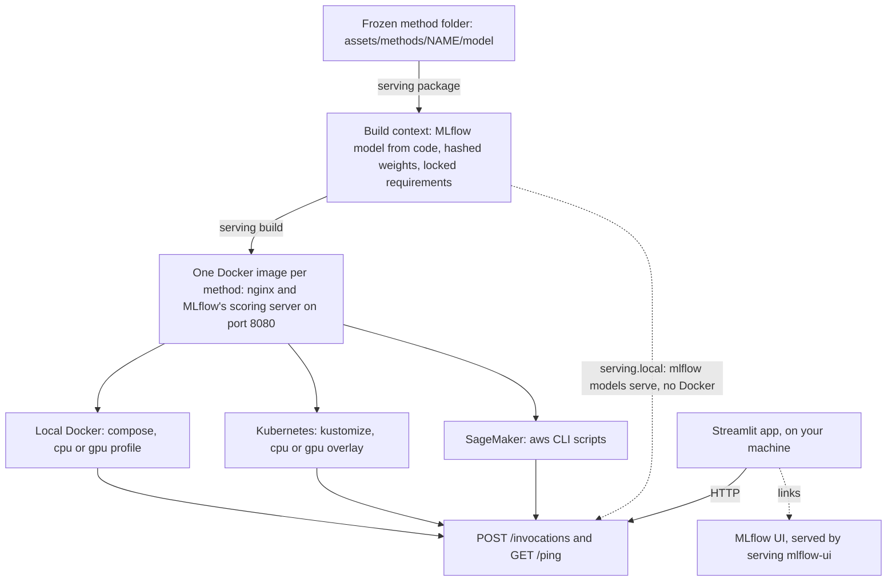

- **Inside the image.** `python:3.12.12-slim`, with nginx on port 8080 in front of MLflow's scoring server (uvicorn, one worker, one prediction at a time). It installs `uv.lock`'s exact pins of the project, of the `serving` group (MLflow) and of the method's own groups with `pip --require-hashes`, and holds the weight files the method folder pins, hashed again. It runs offline, with pickle loading off.
- **No authentication or TLS.** Compose publishes on `127.0.0.1` only, the Kubernetes Service is a ClusterIP, and a SageMaker endpoint sits behind IAM.

### Serve `tfidf` on your machine

Needs Docker with Compose 2.24 or later. A first build downloads the base image and about 188 MB of Python packages; `smoke` also needs the dataset (Quickstart).

```bash
uv run python -m codeforces_tags.serving build --method tfidf                       # codeforces-tags/tfidf:<git short sha> and :latest
METHOD=tfidf docker compose -f deploy/docker-compose.yml --profile cpu up --wait    # serves on http://127.0.0.1:8080
uv run python -m codeforces_tags.serving smoke --method tfidf                       # the first 20 test problems against their frozen rows
```

`build` refuses uncommitted changes to the code, `deploy/Dockerfile` or the method folder (`--allow-dirty` lets them through, and the image tag gets `-dirty`). Once the image is built, it removes the method's older images, every BuildKit build-context cache on the host (not only this method's) and the staged weights; `--keep-previous` keeps them. `smoke` refuses an API method, whose new answer would be a new sample.

**A request** is `POST /invocations` with `Content-Type: application/json` and MLflow's `dataframe_split` of the 7 raw input columns, one row per problem. Every column must be present (a missing one gets a 400); a value may be `null`, the sample inputs and outputs are the JSON text of a list, and a blank statement or solution gets a 500 that names the row. The Quickstart's demo problem, saved as `payload.json`:

```json
{"dataframe_split": {
  "columns": ["prob_desc_description", "prob_desc_input_spec", "prob_desc_output_spec", "prob_desc_notes",
              "prob_desc_sample_inputs", "prob_desc_sample_outputs", "source_code"],
  "data": [["Given a tree with n vertices, count the pairs of vertices at even distance.",
            null, null, null, null, null, "n = int(input())\nprint(n)\n"]]}}
```

Any HTTP client can send it, for example `curl --noproxy '*' -s -X POST http://127.0.0.1:8080/invocations -H 'Content-Type: application/json' -d @payload.json`. The answer, shortened:

```text
{"predictions": [{"method": "tfidf",
  "math": 1, "graphs": 0, "strings": 0, "number theory": 0, "trees": 1, "geometry": 0, "games": 0, "probabilities": 0,
  "score: math": 0.1116057462051529, "score: graphs": -1.1597019929495116, ..., "score: trees": 0.33304455828697266, ...,
  "threshold: math": -0.4202211312010906, ..., "threshold: trees": -0.35704460112154557, ...}]}
```

Each record holds the method's name and one 0/1 column per focus tag. A score method adds each tag's `score: <tag>` and `threshold: <tag>`: the tag is predicted when its score reaches its threshold (`Infinity` for a tag never predicted). An API method adds `failed` and `cost_usd`, and takes one problem per request. `GET /ping` answers 200 once the method has loaded. No `curl` request to `/invocations` was recorded (notebook 12 records `curl` only on `/ping` and an unknown path): the recorded predictions used the project's client (`serving/client.py`, shared by `smoke`, notebook 12 and the app), and this answer was computed offline through the served code path. Its scores are those of the Quickstart's `predict` line.

### The Streamlit client and the MLflow UI

```bash
uv run python -m codeforces_tags.serving mlflow-ui   # optional, once the store is rebuilt: the MLflow UI on 127.0.0.1:5000, until Ctrl-C; then, in another shell:
uv run --group app streamlit run apps/streamlit_app.py
METHOD=tfidf docker compose -f deploy/docker-compose.yml --profile cpu down    # when you are done
```

The app (dependency group `app`, which installs streamlit) runs on your machine, never in a container. It asks the model server at `CODEFORCES_SERVING_URL` (`http://127.0.0.1:8080` by default) about a problem you type or, with the dataset, a test-set problem, and shows each tag's score against its threshold. Its sidebar links the served method to its run in the MLflow UI that `mlflow-ui` serves (`CODEFORCES_MLFLOW_UI_URL`, `http://127.0.0.1:5000` by default). A fresh clone has no MLflow store (`experiments/` is gitignored): `mlflow-ui` refuses to start until the store is rebuilt from committed files ([`notebooks/README.md`](notebooks/README.md), Figures), and until then the sidebar says the MLflow UI does not answer. In a store that lacks the served method, its links say it is not logged there. The app cannot reach a SageMaker endpoint, which takes only IAM-signed requests.


*The app asking a local model server of `f2llm_late_fusion`, on a CPU, about a typed problem: math and number theory, in a 1.31 s round trip. Each bar is a tag's score and the black tick its threshold. From notebook 12.*

### Targets

| Target | How | Status here |
|---|---|---|
| Local Docker, CPU | `METHOD=<name> docker compose -f deploy/docker-compose.yml --profile cpu up --wait` | run, with `f2llm_late_fusion` |
| Local Docker, GPU | The same with `--profile gpu`; needs an NVIDIA driver 580 or later and the NVIDIA Container Toolkit. The two profiles share port 8080, so run one at a time | run, with `f2llm_late_fusion` |
| Kubernetes | `serving manifests --method <name> --device cpu` (or `gpu`) writes a kustomize overlay over [`deploy/k8s/`](deploy/k8s/), then `kubectl apply -k build/k8s/<name>-cpu`; API keys come from the Secret `codeforces-tags-env` | CPU run on a local kind cluster with `tfidf`; GPU overlay: server-side dry run only |
| SageMaker | [`deploy/sagemaker/`](deploy/sagemaker/): `deploy.sh`, `invoke.sh payload.json answer.json`, `delete.sh`, with `METHOD`, `DEVICE`, `AWS_REGION` and `ROLE_ARN` set. Pushes the image to ECR (about 8 GB for `f2llm_late_fusion`, 0.9 GB for `tfidf`) and bills by the hour; refuses API methods | container contract checked locally (`docker run … serve`); scripts tested against a faked aws CLI; no endpoint created |

The full sequences, for kind and for SageMaker, are in the Serving part of the Commands section of [`CLAUDE.md`](CLAUDE.md).

### Which methods can be served

`package` refuses a method that is not registered, not frozen (`f2llm_setfit`) or missing a weight file. API keys come at run time, from `deploy/.env.serving` (gitignored; copy [`deploy/.env.serving.example`](deploy/.env.serving.example)) or the Kubernetes Secret, and are never baked into an image.

| Methods | Package with | At run time | Served here |
|---|---|---|---|
| `tfidf`, `label_prior` | no group, no weights | CPU | `tfidf`: 906 MB image, served and smoke-checked; `label_prior` (0/1 only, no scores) never packaged |
| `f2llm_probe`, `f2llm_late_fusion`, `f2llm_early_fusion` | `--group f2llm` and the 1.19 GB weights (`fetch`) | CPU or GPU | `f2llm_late_fusion`: 7.89 GB image, served on the CPU and on the GPU; the other two never packaged |
| `jev-*` (5 methods) | `--group llm-typesafe` | `TYPESAFE_API_KEY`, network, one problem per request | never packaged |
| `code2tag-*`, `descode2tag-*` | `--group llm` | `OPENAI_API_KEY`, network, one problem per request | `descode2tag-json` packaged, no request sent |
| `modernbert_*` | `--group finetuning`, pretrained weights and 3.3 GB of trained fold models, not published | CPU or GPU | `package` refuses on a fresh clone |

### What was run

Every run below was recorded on 2026-10-11, on a CPU, on a machine shared with other work, except the last, on the GPU (one RTX 2080 Ti) on 2026-10-12; notebook 12 quotes their outputs, with each command and its date (sections 7 and 10 to 12), and [`docs/serving-runs.md`](docs/serving-runs.md) holds the whole record. "0 of 20 differ" means the first 20 test problems got their frozen test rows back, scores within the tolerance that `verify` uses.

| Run | Result |
|---|---|
| `tfidf` image | 906 MB |
| `tfidf` on a local kind cluster, through `kubectl port-forward` | rollout in 30 s; 0 of 20 differ; median 0.024 s, slowest 0.086 s |
| `f2llm_late_fusion` image | built in 188 s; 7.89 GB (6.55 GB of Python packages, 1.21 GB of weights) |
| `f2llm_late_fusion`, compose `cpu` profile | healthy after 17 s; 0 of 20 differ; median 3.395 s, slowest 8.207 s |
| `f2llm_late_fusion`, `docker run … serve` (SageMaker's container contract) | `/ping` 200, an unknown path 404; 0 of 20 differ; median 3.600 s, slowest 7.995 s |
| `f2llm_late_fusion`, `serving.local` (`mlflow models serve`, no Docker) | 0 of 20 differ; median 4.881 s, slowest 11.211 s, over the 10 s budget on the loaded machine |
| `f2llm_late_fusion`, compose `gpu` profile | healthy after 16 s; 2,432 MiB of GPU memory; 0 of 20 differ; median 0.148 s, slowest 0.262 s |

Never run, only written and tested offline: a GPU Kubernetes node, a remote registry, a real SageMaker endpoint, and an API method answering a request. The `tfidf` sequence above was checked in parts: `tfidf` ran on kind, and compose ran with `f2llm_late_fusion`.

## Repository layout

```text
src/codeforces_tags/
  cli.py, cli_methods.py      the codeforces-tags command line
  config.py                   every project-wide setting
  data/, preprocessing/       loading and cleaning
  near_duplicates/            the duplicate detector and its LLM audit
  splitting.py                the frozen dev/test split and folds
  model/                      the TF-IDF tag model
  methods/                    the method framework, one package per family
  llm/                        the toolkit for prompted API methods
  evaluation/, analysis/      metrics, bootstrap, plots
  tuning/, tracking/          Optuna studies, MLflow
  serving/                    package, build, check and serve a method over HTTP
apps/                         the Streamlit client of a model server
deploy/                       Dockerfile, compose file, Kubernetes manifests, SageMaker scripts
assets/                       frozen, committed results (split, verdicts, methods/<name>/)
notebooks/                    12 analyses, committed with outputs
docs/adr/                     architecture decision records
docs/images/                  the figures of this README
docs/slides/                  slide deck
tests/                        offline pytest suite
CLAUDE.md, AGENTS.md          the coding agents' instructions (one text, two titles)
PROBLEM.md                    the task statement
LICENSE, NOTICE               the MIT licence, and the content it does not cover
```

## Notebooks

All 12 are committed with their outputs, so they render on GitHub without the data. To re-run, each needs the dataset (if `CODEFORCES_DATA_DIR` is set, as an absolute path: the kernel runs in `notebooks/`), and several assert the frozen numbers, so another copy of the data fails by design. None needs an API key or a GPU, or sends a request to a paid API, and each runs in about a minute with the default `uv sync`, unless its last column says otherwise. The commands are in [`notebooks/README.md`](notebooks/README.md).

| Notebook | Question | Key result | To re-run, beyond the dataset |
|---|---|---|---|
| [01 Dataset overview](notebooks/01_dataset_overview.ipynb) | What is in the data, and which inputs carry signal? | 46.2% of problems have no focus tag; `math` 28.3% against `probabilities` 1.8%; `math`'s share rose from 19.4% (to 2017) to 36.4% (from 2019) | nothing |
| [02 Near-duplicates](notebooks/02_near_duplicates.ipynb) | Do near-duplicates threaten the split, and how are they found? | One threshold fails both ways (0.8 misses 11 of 82 pairs, 0.4 links 121 non-duplicates); two stages keep all 82, in groups of at most 2 | nothing: the LLM verdicts are frozen |
| [03 Train/test split](notebooks/03_train_test_split.ipynb) | How to cut dev, test and 5 folds with no leak and balanced tags? | Over 50 seeds, stratified splits leak 0 pairs against 17 to 34 for random splits by problem, and put tag shares 1.5% off on average against 9.4% | nothing |
| [04 TF-IDF baseline](notebooks/04_tfidf_baseline.ipynb) | How good is a tuned TF-IDF model, what does it read, and are its scores probabilities? | Dev 0.663 [0.642, 0.683], test 0.689; statement alone 0.641, code alone 0.370; a Platt map changes none of 31,904 predictions | about 17 minutes (46 pipeline fits) |
| [05 Zero-shot LLM](notebooks/05_zero_shot_llm.ipynb) | How do the paper's two prompts do with gpt-6-luna? | `descode2tag-json` dev 0.732, +0.069 [0.051, 0.087] over TF-IDF; JSON beats free text for DesCode2Tag by +0.026 [0.014, 0.037], with no difference detected for Code2Tag; the study cost $1.94 | nothing: the answers are committed |
| [06 ModernBERT LoRA](notebooks/06_modernbert_lora.ipynb) | Does LoRA fine-tuning of ModernBERT-large beat TF-IDF? | Dev 0.661, paired −0.002 [−0.018, 0.014]; test 0.695; 10.9 s per problem at the median on a CPU | group `finetuning` and the pinned tokenizer (`modernbert fetch`) |
| [07 ModernBERT base](notebooks/07_modernbert_base_full.ipynb) | Does fine-tuning every weight of ModernBERT-base do better? | Dev 0.653, paired −0.010 [−0.027, 0.007] against TF-IDF; the highest of TF-IDF and the two ModernBERT models on test (0.704), the lowest of them on dev | group `finetuning` and the `fetch` of both ModernBERT methods |
| [08 TypeSafe Jev](notebooks/08_typesafe_jev.ipynb) | Does Jev beat the trained baselines, and does the solution help? | Dev 0.729, +0.066 [0.050, 0.083] over TF-IDF; the solution adds 0.000 [−0.008, 0.009]; a fixed 0.5 cut costs −0.039 | nothing: the answers are committed |
| [09 F2LLM](notebooks/09_f2llm.ipynb) | Do frozen F2LLM embeddings add to TF-IDF? | Probe dev 0.709, +0.046 [0.031, 0.060] over TF-IDF, +0.045 without the 66 problems whose solution names its own problem; the three heads are level | nothing: no torch, no weights |
| [10 Jev GEPA](notebooks/10_jev_gepa.ipynb) | Can a search over Jev's words beat frozen Jev? | +0.006 [−0.006, 0.022] on the held-out fold 0, −0.025 [−0.041, −0.010] on test, for $9.95 | nothing |
| [11 Jev Platt](notebooks/11_jev_platt.ipynb) | Are Jev's probabilities calibrated, and does a Platt + Lipton rule help? | Mean expected calibration error 0.053 → 0.011; the rule gains +0.009 [0.001, 0.017] on dev, −0.006 [−0.013, 0.001] on test | nothing |
| [12 Model serving](notebooks/12_model_serving.ipynb) | How is a frozen method served, and does it answer as the frozen one? | `f2llm_late_fusion` live on a CPU: 3 test problems in 1.6 to 1.9 s, each matching its frozen test row within the tolerance `verify` uses; recorded compose, `docker run` and kind runs: 0 of 20 differ | group `f2llm`, the F2LLM weights, and no uncommitted changes to the code, `deploy/Dockerfile` or the method folder; no Docker; writes 1.2 GB under `build/` |

## Limitations and caveats

- **Small test set.** Test intervals are about ±0.03 on macro F1 and ±0.13 to 0.15 on `probabilities`, the rarest tag (18 test positives). The order of the top methods on test is not significant, and it differs from the order on dev.
- **One run per method.** The intervals resample problems, not runs. Each API method's score comes from one answer per problem, and how much a second set of answers would move it was not measured; for ModernBERT, a GPU retrain moved the dev score by up to 0.027 (below). The order inside the top tier may not survive a rerun.
- **Contamination.** Every problem is public and was released by 2022-11-21, years before the pretrained models used here were trained. gpt-6-luna and ModernBERT may have read Codeforces pages, Qwen3 (F2LLM's base) may have too, and Jev's training data is not disclosed. Dropping the 66 problems whose solution names its own problem moves no macro F1 by more than 0.003, which does not rule out memorisation. Gains over TF-IDF are upper bounds, and the comparison of Jev with the zero-shot prompts cannot tell recall from inference for either.
- **Exploration before the split.** Notebook 01 explored all 4,982 problems, test included, before the split was frozen. Jev's tag definitions and the TF-IDF search space were written after it, so they may carry a little knowledge of the test problems' statistics, though no model was fitted or chosen on test.
- **Unequal information, untested.** Jev gets a written definition per tag; the paper's prompts list tag names only. Jev and the trained methods get per-tag thresholds; the zero-shot methods do not. No ablation separates these.
- **LLM baselines at a cheap setting.** gpt-6-luna ran at reasoning effort none; higher effort was not tried.
- **API methods.** A prediction sends the statement and solution to the provider. Answers have no seed, and a pinned model can be retired. Frozen numbers come from the committed answers, not from asking again.
- **Latency.** API timings come from the author's machine and include the network. A fresh command also loads the method: `f2llm_probe` (12.3 s), `modernbert_lora` (10.8 s) and `modernbert_base_full` (26.7 s) exceed 10 s cold, and on a CPU `modernbert_lora` exceeds 10 s even at the median (10.9 s, up to 19.6 s), `modernbert_base_full` at its slowest problem (13.6 s; 3.9 s at the median).
- **Fine-tuned models.** ModernBERT's configuration was chosen on dev fold 0, and GPU training is not bit-reproducible: two retrains of `modernbert_lora` scored 0.634 and 0.642 out of fold, below the frozen bag (0.661) and TF-IDF (0.663).
- **Labels.** Codeforces tags are the setters' choice and noisy: 41 problems have no tag at all, and a few of them look like tree, graph or game problems.
- **Near-duplicate verdicts** come from two LLM judges, who can share blind spots; a human check of a sample is still to do.
- **A single-commit snapshot.** This public repository is one commit, a snapshot of the private history the project was developed in. The commit ids in run records, answers files, notebooks, ADRs and settings name commits of that history, which are not here. So the commit checks refuse here, by design: the `verify` of the Jev methods, and the `export`, `freeze` and `verify` of the calibrated Jev twins, compare the last commit of an answers file, or of a twin's base file, with the one that its run record or `tuning/params.json` holds. The sha256 checks, and every other `verify`, work here with the dataset.
- **Serving.** No model server has run on a GPU Kubernetes node or on SageMaker, and none has authentication or TLS (Serving, above).
- **Platforms.** CI runs on Ubuntu only.

## Data and licences

The repository holds content under three licences; [`NOTICE`](NOTICE) lists the same, with the paths.

- **MIT** ([`LICENSE`](LICENSE)): everything that the next two items do not name, that is the code, the frozen results, and the documentation and figures written for this project.
- **[CC BY-NC 4.0](https://creativecommons.org/licenses/by-nc/4.0/)**: excerpts of the dataset, the problem statements and solutions of [codeforces.com](https://codeforces.com) that xCodeEval (Khan et al., ACL 2024; Citation, below) collected, in places truncated or normalised. They appear in the outputs of some notebooks, in four figures ([`notebooks/figures/mlflow/03_record_drawer.png`](notebooks/figures/mlflow/03_record_drawer.png), [`notebooks/figures/mlflow/07_trace_drawer.png`](notebooks/figures/mlflow/07_trace_drawer.png), [`notebooks/figures/streamlit/test_problem.png`](notebooks/figures/streamlit/test_problem.png) and [`docs/slides/images/trace_drawer.png`](docs/slides/images/trace_drawer.png)), as the first few words of statements in two more ([`notebooks/figures/mlflow/02_dataset_records.png`](notebooks/figures/mlflow/02_dataset_records.png) and [`notebooks/figures/mlflow/11_traces_cost.png`](notebooks/figures/mlflow/11_traces_cost.png)), and in the deck ([`docs/slides/slides.pdf`](docs/slides/slides.pdf), [`docs/slides/slides.html`](docs/slides/slides.html)). They are not covered by the MIT licence: a use of them credits xCodeEval and stays non-commercial.
- **Apache-2.0**: the three figures of MLflow's documentation in [`notebooks/figures/mlflow_docs/`](notebooks/figures/mlflow_docs/), with MLflow's licence ([`LICENSE-mlflow.txt`](notebooks/figures/mlflow_docs/LICENSE-mlflow.txt)) and a README that names each source, and their copies embedded in notebook 12.

The rest of what this repository uses or records:

- **The dataset.** [xCodeEval](https://huggingface.co/datasets/NTU-NLP-sg/xCodeEval) is licensed CC BY-NC 4.0 by its paper and the authors' GitHub README; its Hugging Face card has said CC BY 4.0 since September 2025. This repository follows the stricter of the two. The dataset is not shipped here (Data, above).
- **Method folders** hold no statement and no solution. The skops models of `tfidf`, `f2llm_late_fusion` and `f2llm_early_fusion` hold the fitted TF-IDF vocabularies: 43,354 single words and word pairs of the statements and notes, and 2,354 single tokens of the solutions; nothing longer.
- **Pretrained models.** None is shipped here: the `fetch` commands download them, pinned by revision and sha256. Their licences, as their model cards state them:
  - [`answerdotai/ModernBERT-base`](https://huggingface.co/answerdotai/ModernBERT-base) (`modernbert_base_full`): Apache-2.0.
  - [`answerdotai/ModernBERT-large`](https://huggingface.co/answerdotai/ModernBERT-large) (`modernbert_lora`): Apache-2.0.
  - [`codefuse-ai/F2LLM-0.6B`](https://huggingface.co/codefuse-ai/F2LLM-0.6B) (the `f2llm_*` methods): Apache-2.0. An image that `serving build` makes for an F2LLM method holds these weights, under that licence.
- **Provider outputs.** The answers files, `assets/methods/*/answers_*.jsonl`, are the responses of OpenAI's and TypeSafe's APIs, recorded for this project: tag lists or per-tag probabilities, request ids, hashes and token counts, never keys or problem text. The near-duplicate verdicts (`assets/near_duplicates/`) were written by two Claude judges, and the words that the GEPA search rewrote (`assets/methods/jev-statement-code-gepa/tuning/`) by gpt-6-luna, both for this project.

## Citation

If you use the data, cite xCodeEval:

> Mohammad Abdullah Matin Khan, M Saiful Bari, Xuan Long Do, Weishi Wang, Md Rizwan Parvez and Shafiq Joty. *XCodeEval: An Execution-based Large Scale Multilingual Multitask Benchmark for Code Understanding, Generation, Translation and Retrieval.* In Proceedings of the 62nd Annual Meeting of the Association for Computational Linguistics (ACL 2024), Volume 1: Long Papers, pages 6766-6805, 2024. [doi:10.18653/v1/2024.acl-long.367](https://doi.org/10.18653/v1/2024.acl-long.367); preprint [arXiv:2303.03004](https://arxiv.org/abs/2303.03004).

```bibtex
@inproceedings{khan-etal-2024-xcodeeval,
    title = "{XC}ode{E}val: An Execution-based Large Scale Multilingual Multitask Benchmark for Code Understanding, Generation, Translation and Retrieval",
    author = "Khan, Mohammad Abdullah Matin  and
      Bari, M Saiful  and
      Do, Xuan Long  and
      Wang, Weishi  and
      Parvez, Md Rizwan  and
      Joty, Shafiq",
    editor = "Ku, Lun-Wei  and
      Martins, Andre  and
      Srikumar, Vivek",
    booktitle = "Proceedings of the 62nd Annual Meeting of the Association for Computational Linguistics (Volume 1: Long Papers)",
    month = aug,
    year = "2024",
    address = "Bangkok, Thailand",
    publisher = "Association for Computational Linguistics",
    url = "https://aclanthology.org/2024.acl-long.367/",
    doi = "10.18653/v1/2024.acl-long.367",
    pages = "6766--6805"
}
```

The preprint, as arXiv exports it:

```bibtex
@misc{khan2023xcodeevallargescalemultilingual,
      title={xCodeEval: A Large Scale Multilingual Multitask Benchmark for Code Understanding, Generation, Translation and Retrieval},
      author={Mohammad Abdullah Matin Khan and M Saiful Bari and Xuan Long Do and Weishi Wang and Md Rizwan Parvez and Shafiq Joty},
      year={2023},
      eprint={2303.03004},
      archivePrefix={arXiv},
      primaryClass={cs.CL},
      url={https://arxiv.org/abs/2303.03004},
}
```
