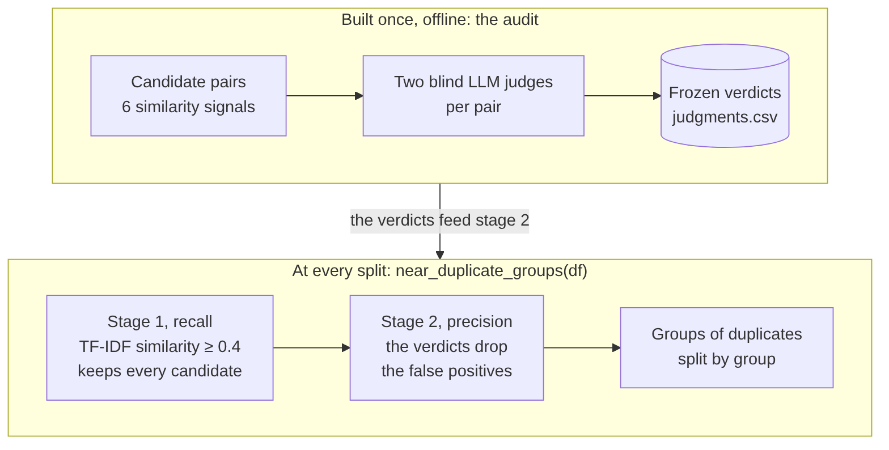

# Near-duplicate audit

Near-duplicate problems, mostly easy and hard versions with the same tags, must stay on the same side of a train/test split. A pair split across train and test leaks data and inflates the test score. This audit checks how well a TF-IDF detector finds them. Candidate pairs from several signals were judged blind by two independent LLM judges.

- **Thresholds.** The verdicts give a recall and a precision for every threshold from 0.4 up.
- **Misses.** They bound the duplicates the detector misses among weakly flagged pairs and among pairs from the same round.
- **Not sampled.** Pairs from different rounds that no signal flags (about 12.4 million) were never sampled. Only the signals cover them: character similarity, identical sample input, similar code.

How the detector works: the audit runs once, and the two stages run at every split.



Source: [`notebooks/figures/near_duplicate_pipeline.mmd`](../../notebooks/figures/near_duplicate_pipeline.mmd).

The verdicts are now the second stage of the default detector. `near_duplicate_groups()` in `codeforces_tags.near_duplicates.detection` takes TF-IDF candidates at 0.4. It then reads `judgments.csv` (`config.NEAR_DUPLICATE_VERDICTS`) and drops the pairs judged not duplicates. Editing that file changes every split.

The method and the results, with examples of false positives and false negatives, are explained in [`notebooks/02_near_duplicates.ipynb`](../../notebooks/02_near_duplicates.ipynb).

## Reproduce

The pipeline lives in `codeforces_tags.near_duplicates.audit`, with its prompt templates in [`templates/`](../../src/codeforces_tags/near_duplicates/audit/templates/). Its settings are in `config.py`:
- the candidate threshold and field under "Near-duplicate statements";
- the rest under "Near-duplicate audit": signal thresholds, sample sizes, seeds, text limits, pairs per judge, model and effort.

The judges' permissions are fixed in `judges.py`. Each step reads and writes one working folder. To reproduce the recorded audit:

```bash
uv run python -m codeforces_tags.near_duplicates.audit build-pairs /tmp/audit --recall-check
uv run --group audit python -m codeforces_tags.near_duplicates.audit judge first_pass /tmp/audit
uv run --group audit python -m codeforces_tags.near_duplicates.audit judge second_pass_round_1 /tmp/audit
uv run --group audit python -m codeforces_tags.near_duplicates.audit judge second_pass_round_2 /tmp/audit
uv run python -m codeforces_tags.near_duplicates.audit merge /tmp/audit
```

1. **`build-pairs`** writes the pairs to judge in `pairs_to_judge.csv`, and the texts the first judge reads in `texts/batch_<k>.json`, at most 52 pairs per judge.
   - **By default**, the pairs are the detector's stage-1 candidates alone: TF-IDF similarity ≥ 0.4, 203 pairs here. They come from the detector's blockwise similarity.
   - **With `--recall-check`**, as in the recorded audit, it also builds tiers B to D below the threshold, to check that the threshold misses no duplicate. It writes every pair flagged by a signal to `candidates.csv`.
   - **Byte-identical output.** With `--recall-check`, `candidates.csv` and the batch files come out byte-identical to the ones judged. `pairs_to_judge.csv` has the same pairs, tiers and word similarities. It also fills in the other signals of the tier D control pairs, which the recorded file left empty.
2. **`judge <pass>`** runs one judge per prompt, after rendering the pass's prompts from `templates/<pass>.j2` into `prompts/<pass>_<k>.txt`.
   - **Answers.** Each valid answer is saved as soon as it arrives in `answers/<pass>_<k>.json`, with its labels, cost, token usage and tool calls. Running the pass again only judges the batches that failed or are missing. Once every batch has an answer, they go to `judgments_raw.json`.
   - **Run record.** `run_<pass>.json` records the agent options, the SDK version and the total cost.
   - **Round 2** also writes its `texts/second_batch_<k>.json` files.
   - **Confinement.** The judges run in `texts/` and can read nothing outside it, so the first judge's answers stay out of the second judge's reach.
   - **`--dry-run`** writes the prompts without calling any model.
   - **Requirements.** Judging needs the `audit` dependency group (`claude-agent-sdk`) and Claude credentials: `ANTHROPIC_API_KEY`, or a Claude Code login.
3. **`merge`** applies the final rule and writes `judgments.csv` and `confirmed_pairs.csv`. It refuses to run until every pair has both judges' labels.

To rebuild the committed tables from the recorded answers without calling a model, copy `judgments_raw.json` into the folder after `build-pairs --recall-check`, then run `merge`. The output is byte-identical to the files here.

### Scaling to more problems

- **Only candidates are judged.** Without `--recall-check`, only the stage-1 candidates go to the judges: 203 of the 12.4 million pairs here. The judging cost grows with the candidates, not with the pairs.
- **Judges grow in number, not in load.** Each judge reads at most 52 pairs (`config.AUDIT_PAIRS_PER_JUDGE`), so more candidates mean more judges.
- **The recall check stays a one-off.** The recorded audit judged the tiers below the threshold once, to show that 0.4 misses no duplicate. Its signal matrices are square in the number of problems, so it does not scale and is not repeated.
- **The next limit is stage 1 itself.** Comparing every pair by TF-IDF takes time quadratic in the number of problems, even computed in blocks. Far beyond this dataset, approximate nearest neighbours (for example MinHash LSH) would find the candidates instead.

## The judges

| Setting | Value |
|---|---|
| Model | `claude-opus-5-5` (`config.AUDIT_JUDGE_MODEL`) |
| Reasoning effort | `xhigh` (`config.AUDIT_JUDGE_EFFORT`), extended thinking on |
| Temperature, token limits | Harness defaults, never set |
| Output | Structured, validated against [`templates/labels.schema.json`](../../src/codeforces_tags/near_duplicates/audit/templates/labels.schema.json): one `pair_id`, `label`, `confidence` and `reason` per pair |
| Prompts | Jinja2 templates in [`templates/`](../../src/codeforces_tags/near_duplicates/audit/templates/): the shared `definitions.j2`, included by one template per pass |

**What the recorded run looked like.** The recorded run of 2026-10-04 used Claude Code 2.1.284 workflow subagents. Each judge received:
- the rendered prompt, indented under a harness header;
- the subagent system prompt;
- the repository's `CLAUDE.md`, which gives duplicate counts but no pair labels.

The first-pass and round-1 judges were also relayed the user question that triggered the run (a question about how the threshold was set and how to rule out missed pairs). The round-2 judges were not.

The judges used Read and Bash to read their batch file. 20 judges answered: 10 in the first pass, 1 in round 1, 9 in round 2. The transcripts (not published) hold 30 prompts, because 10 first-pass launches were interrupted after a few seconds and relaunched with the same prompts. Only the relaunched answers are used. Rendering the templates reproduces every one of these prompts exactly.

**How `judge` reruns it.** `judge` uses the Claude Agent SDK with the same model, effort, prompt and schema. The differences from the recorded run:
- **System prompt.** It uses the SDK's own minimal system prompt.
- **CLI version.** It uses the Claude Code CLI bundled with the SDK (2.1.286 with `claude-agent-sdk` 0.2.163).
- **Context.** It loads no `CLAUDE.md` and relays no question.
- **Tools.** The judge has a single tool, Read, allowed inside `texts/` only (`tools=["Read"]`, `allowed_tools=["Read(./**)"]`, `permission_mode="dontAsk"`). This was checked against the real CLI: reading `../judgments_raw.json` or the repository is refused, and Bash does not exist for the judge.

**What the judges see.** Each pair shows both statements: description (first 2,500 characters), input spec (700) and output spec (400). Sample ids, similarity scores, signals, tiers and the other judge's labels are hidden.

## Judging rules

1. **First pass:** 10 judges, one per `batch_<k>.json`, label all 485 pairs.
2. **Second pass, round 1:** one judge re-labels the first-pass calls that decide the former 0.8 threshold's errors, plus the low-confidence ones. That means duplicates below 0.8, non-duplicates at or above 0.8, and `low` confidence: 22 pairs.
3. **Second pass, round 2:** 9 judges re-label every other pair (463), in `pair_id` order, about 51 per `texts/second_batch_<k>.json`. Every pair then has two judges. By that point the first labels were saved in the working folder. So the round-2 prompt forbids opening any other file, and `judge` also enforces it. The recorded agents' tool calls show that each one read only its own batch.
4. **Final rule:** a pair is a duplicate when at least one judge says `same_problem` or `versions`. A wrong link only keeps two problems on the same side of a split, while a wrong cut leaks. The judges agree on duplicate vs not for 484 of 485 pairs. The exception is pair 393 (problems 1028 and 3366), labelled `versions` by the first judge and `related` by the second, which counts as a duplicate.

## Files

| File | Content |
|---|---|
| `judgments.csv` | One row per judged pair (485), with the columns below. Read by `near_duplicate_groups()` |
| `confirmed_pairs.csv` | The 82 duplicate pairs with both judges' labels and reasons, a readable subset of `judgments.csv` |
| `judgments_raw.json` | The judges' answers: `first`, then the second pass's two rounds (`second`, `second_round_2`), with the pair ids each round was asked for |
| `audit_metadata.json` | Candidate signals, tier sizes and seeds, what the judges saw, judging rules, the judges' settings, results |

Statement texts are not stored here (the dataset is not redistributed). Pairs are identified by `sample_id`, the number in `sample_<id>.json`.

## Columns of `judgments.csv`

The detector reads three columns: the two sample ids and `final`. Notebook 02 analyses the similarity, the tier and the judges' answers. The other signals are the audit trail: they decided which tier each pair fell into when the pairs were built, so anyone can check why a pair was judged.

| Column | Meaning | Used by |
|---|---|---|
| `pair_id` | Id shown to the judges | Audit trail: the key into `judgments_raw.json` and the batch texts the judges read |
| `sample_id_a`, `sample_id_b` | The two problems | Detector (`load_verdicts`), notebook 02 |
| `tier` | Why the pair was judged: A (word cosine ≥ 0.4, all), B (below 0.4 but a strong signal, all), C (below 0.4 with a weak signal only, sampled), D (same contest with no signal, random control) | Notebook 02 |
| `word_cosine` | Similarity used by the detector: TF-IDF of word 1–2 grams on `prob_desc_description` | Notebook 02 |
| `char_cosine` | TF-IDF of character 3–5 grams on `prob_desc_description` | Audit trail (tier B: ≥ 0.6 is a strong signal) |
| `code_cosine` | TF-IDF of the solutions' code tokens | Audit trail (≥ 0.85 flags a candidate) |
| `same_contest` | Same release timestamp, i.e. the same Codeforces round | Audit trail (tiers B and D) |
| `same_sample_in`, `same_sample_out` | Identical example inputs or outputs | Audit trail (an identical input flags a candidate) |
| `both_version` | Both statements mention an "easy/hard version" | Audit trail (tier B) |
| `judge1_*` | First judge: label, confidence, reason | Notebook 02 |
| `judge2_*` | Second, blind judge: label, confidence, reason. Which round each label came from is in `judgments_raw.json` (`sent_to_second`, `sent_to_second_round_2`) | Notebook 02 |
| `final` | `duplicate` when at least one judge says `same_problem` or `versions`, else `not_duplicate` | Detector, notebook 02 |
